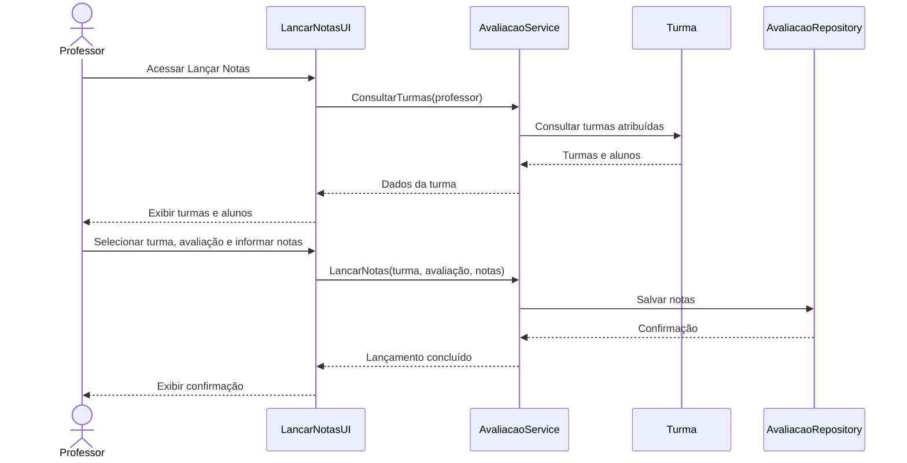

# Exercícios 1 a 3 — Sistema de Controle Acadêmico

## Exercício 1 — Caso de uso: Lançar Notas (fluxo principal)

**Ator principal:** Professor.  
**Objetivo:** Registrar as avaliações dos alunos de uma turma sob sua responsabilidade.  
**Pré-condições:** Professor autenticado, turma atribuída e prazo institucional de lançamento válido.  
**Pós-condição:** Notas registradas para consulta e apuração acadêmica.

1. O professor acessa a funcionalidade **Lançar Notas**.
2. O sistema apresenta as turmas atribuídas ao professor.
3. O professor seleciona uma turma e a avaliação que deseja registrar.
4. O sistema identifica a turma, verifica a atribuição do professor e o prazo e apresenta os alunos inscritos.
5. O professor informa as notas e confirma o lançamento.
6. O sistema valida os dados e registra as notas dos alunos.
7. O sistema apresenta a confirmação do registro.

O enunciado anterior não define todos os campos da avaliação; portanto, o fluxo considera genericamente a avaliação selecionada, sem inventar fórmulas ou critérios adicionais.

## Exercício 2 — Diagrama de sequência: Lançar Notas

O diagrama é conceitual e utiliza classes de fronteira, serviço e persistência pertinentes ao caso de uso. O programa prático dos exercícios 4 e 5 foi limitado a **Aluno** e **Turma**, conforme o diagrama específico da atividade.

## Exercício 3 — Multiplicidades (conforme diagrama apresentado)

| Classes | Multiplicidades |
|---|---|
| Aluno – Turma | **2..5 alunos por turma** e **0..* turmas por aluno** |

**Observação:** a turma pode ser cadastrada com zero ou um aluno enquanto permanece fechada. A exigência de dois alunos ocorre para sua abertura. Uma turma aberta comporta de 2 a 5 alunos.
